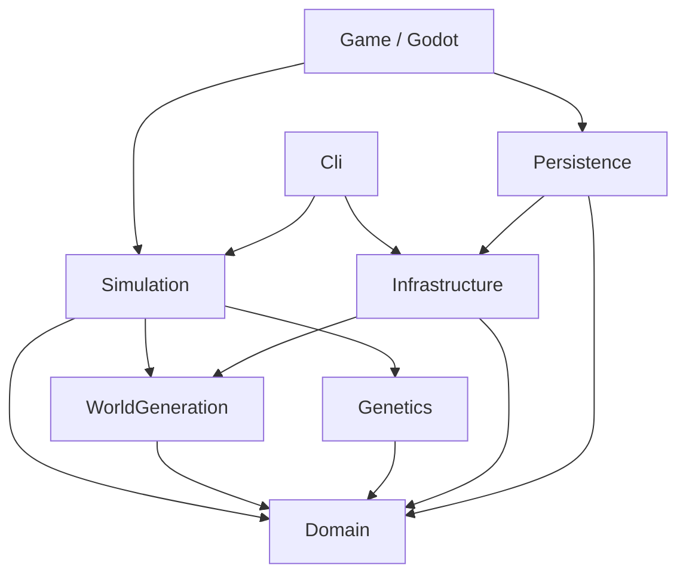

# Arquitetura

O estado e as regras existem sem Godot. A mesma `SimulationEngine` é usada pelo jogo, pelo CLI e pelos testes. Não há referência gráfica nos módulos internos.

| Projeto | Responsabilidade |
|---|---|
| Domain | Estado de mundo/agentes/colônias, biomas, genes, PRNG e contrato de armazenamento |
| WorldGeneration | Distribuição de biomas, terreno e recursos, com streams separados |
| Genetics | Herança e mutações limitadas; nenhuma função de fitness imposta |
| Simulation | Orquestração de ticks, ambiente, agentes, combate, reprodução e navegação |
| Infrastructure | Codec binário, validação de snapshots, escrita atômica de arquivo e exportação SVG |
| Persistence | Microsoft.Data.Sqlite, transações, schema e logs estruturados |
| Game | Composição dos serviços, input, câmera, HUD e renderização |
| Cli | Execução sem janela, métricas JSON e save/load de arquivo |

`WorldMap` oferece acesso lógico sobre `ChunkManager`. Células compactas ficam em arrays contíguos por chunk; recursos são esparsos. `CellGrid` mantém as APIs indexadas legadas sem duplicar arrays. Metadados por coluna e um plano global esparso garantem continuidade da geração. O renderer instancia só chunks visíveis e invalida bordas vizinhas após alterações.

Caches de navegação são derivados. O snapshot v3 referencia `WorldGeneration` para reconstruir a seed antes de aplicar deltas. Isso mantém a direção das dependências e evita serializar terreno base. O índice de fontes renováveis é atualizado quando a presença de recursos muda. Consulte [detalhes dos blocos](world-blocks.md).

Cada tick atualiza biologia, reconstrói o índice espacial, distribui decisões pelo cursor persistido e executa ações validadas. Ambiente/prioridades coletivas usam intervalos de tempo simulado. A ordem de execução gira a cada tick; combate tem cooldown e dano imediato validado. Mortos são removidos depois das ações. Ovos são acrescentados após o conjunto de agentes que iniciou o tick. Veja [arquitetura dos agentes](agents-ai.md).

A thread principal é a única dona do estado. Save/load ocorre entre ticks; não há concorrência de leitura/escrita. Políticas de longevidade e fronteiras de armazenamento têm contratos explícitos. Os sistemas internos são concretos e pequenos, evitando contêiner de injeção e abstrações sem uso.

`SimulationClock` recebe segundos reais, converte-os em ticks de 0,05 segundo simulado e mantém o excedente. No jogo, a chamada respeita limite de ticks e orçamento de 45% do tempo-alvo do frame (7,5 ms a 60 FPS), verificado entre ticks; um tick individual não é interrompido. Não se descarta tempo quando o computador fica atrasado. O CLI executa ticks diretamente.

`AntWorld.Core.sln` compila apenas projetos sem pacotes externos. `AntWorld.sln` inclui também Godot, SQLite e xUnit. Os cenários em `tests/Shared` são executados por wrappers xUnit e pelo console de verificação; não há substitutos falsos para bibliotecas ausentes.

`AntWorld.XunitRunner` usa `XunitTestFramework` para descobrir e executar os testes nas três assemblies, esperando a mensagem real de término de cada execução. Isso elimina a necessidade do canal TCP do VSTest em sandboxes. Não chama os métodos de teste diretamente e falha para testes ignorados, erros ou execução vazia. A única supressão de analyzer é xUnit3000 no sink de mensagens: este runner .NET 10 não usa AppDomains/remoting.

O projeto gráfico reconhece `-- --smoke-test` para exercitar relógio, SQLite e atualização do observatório, e `-- --capture=/caminho/imagem.png` para captura opcional após renderização (requer display funcional). O teste usa um slot separado, `smoke-test`.
